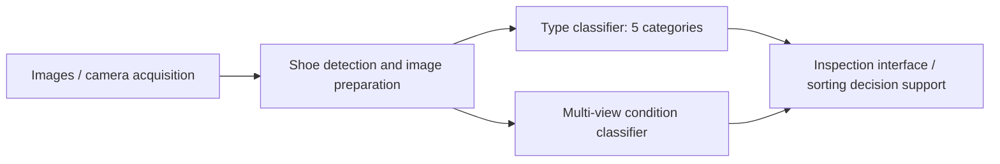
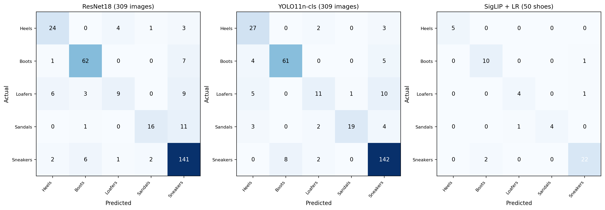
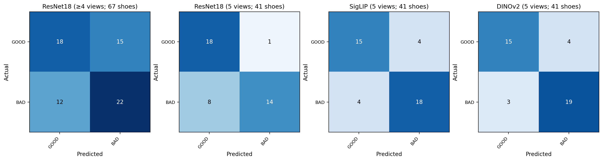

# Analysis of Shoe Type and Condition Using AI for Automated Circular Sorting

**Master’s degree project · Artificial Intelligence and Automation · University West, Sweden**  
**Researcher:** Mulubrhan Abebe Nerea  
**Department:** Engineering Science  
**Industrial project context:** Wargön Innovation (Testlina experimental facility)

> Multi-view computer vision for shoe type recognition and condition-aware circular sorting. **Reported scores are validation results, not measured end-to-end industrial sorting accuracy.**

## At a glance

| Task | Best recorded approach | Validation accuracy | Macro F1 | Evaluation unit |
|---|---|---:|---:|---|
| Shoe type | Frozen SigLIP + logistic regression, multi-view score fusion | **90.00%** (45/50) | **0.8950** | 50 shoes |
| Condition (GOOD/BAD) | Frozen DINOv2 + mean-pooled views + MLP | **82.93%** (34/41) | **0.8276** | 41 shoes |

For condition classification, the DINOv2 model identified **19/22 BAD shoes (86.36% recall)** in validation.

## Research problem

Footwear sorting for reuse requires identifying both **shoe type** and **reusability condition**. This project investigates AI-based inspection using multi-view images, with the goal of supporting sorting decisions and reducing reliance on exclusively manual inspection.

## Inspection workflow

The five type categories are **Klackskor (heels), Kängor och boots, Loafers, Sandaler, Sneakers**. Condition labels are **GOOD** and **BAD**. The validated condition models require multiple views of the same shoe; single-frame conveyor performance has not been established by these results.

## Shoe type classification — validation

| Model | Unit / sample size | Accuracy | Macro precision | Macro recall | Macro F1 |
|---|---|---:|---:|---:|---:|
| ResNet18 baseline | Image, 309 | 81.55% | 0.78 | 0.69 | 0.72 |
| ResNet18 + UT Zappos50K | Image, 309 | 79.94% | 0.72 | 0.71 | 0.72 |
| YOLO11n-cls (retrained run) | Image, 309 | 84.14% | 0.8079 | 0.7471 | 0.7657 |
| SigLIP zero-shot | Image, 231 | 83.12% | 0.81 | 0.75 | 0.7510 |
| SigLIP + logistic regression | Shoe, 50 | **90.00%** | **0.9100** | **0.8852** | **0.8950** |

**Interpretation:** These evaluations use different validation samples and, importantly, different prediction units (images versus shoes). Scores should not be treated as a controlled head-to-head comparison.

## Shoe condition classification — validation

| Model | Validation shoes | Accuracy | Macro precision | Macro recall | Macro F1 |
|---|---:|---:|---:|---:|---:|
| ResNet18 (≥4 views) | 67 | 59.70% | 0.60 | 0.60 | 0.60 |
| ResNet18 (5 views) | 41 | 78.05% | 0.81 | 0.79 | 0.78 |
| SigLIP (5 views) | 41 | 80.49% | 0.8038 | 0.8038 | 0.8038 |
| DINOv2 (5 views) | 41 | **82.93%** | **0.8316** | **0.8266** | **0.8276** |

**Interpretation:** The ≥4-view configuration uses a different validation cohort; its lower score does not isolate the effect of missing viewpoints. The 41-shoe five-view validation set is small.

## Prototype and industrial context

The research explores an inspection application with image uploads, multi-camera acquisition, and shoe detection/cropping (including experiments with Grounding DINO). Classification validation results do **not** establish reliable continuous-conveyor throughput or end-to-end deployment accuracy.

## Repository guide

- [`assets/`](assets/) — reproducible visualizations from verified confusion-matrix counts.
- [`results/`](results/) — numerical validation metrics in CSV form.
- [`docs/`](docs/) — placeholder for an approved thesis PDF and finalized academic poster.
- Training/inference code, model weights, and dataset samples can be added after confirming they are the exact evaluated versions and are approved for public distribution.

## Reproducibility and responsible use

This repository currently presents **research results and documentation**, not a runnable end-to-end model. Do not assume that Wargön Innovation imagery, institutional logos, or third-party datasets are redistributable. No dataset, proprietary image, or unverified poster is included.

## Citation

Abebe Nerea, Mulubrhan. *Analysis of Shoe Type and Condition Using AI for Automated Circular Sorting*. Master's degree project, Department of Engineering Science, University West. (Add final publication year and repository DOI when available.)

## Contact

Author: **Mulubrhan Abebe Nerea** · University West, Sweden.
